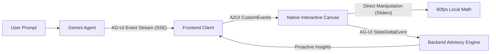

# OmniCalc Agent: A2UI + AG-UI Hybrid Calculator Sample Project

A production-grade sample project demonstrating how **Google's A2UI** (Agent-to-User Interface) declarative UI standard and **AG-UI** (Agent-User Interaction Protocol by CopilotKit) work together to build **agentic, generative user interfaces**.

---

## 💡 What is A2UI & AG-UI?

| Protocol | Role | Layer | What It Does |
| :--- | :--- | :--- | :--- |
| **AG-UI** | **Transport** | Server-Sent Events (SSE) | Standardizes the streaming connection between agent backends and frontends (`RunStarted`, `TextMessageContent`, `ToolCallStart`, `StateDeltaEvent`, `CustomEvent`). |
| **A2UI** | **Presentation** | Declarative JSON Schema | Emits structured JSON component definitions (`Card`, `Slider`, `Metric`, `ChoicePicker`, `Row`, `Column`) rather than raw code. Maps safely to native local widgets (zero XSS risk). |



---

## 🧮 Included Calculator Modules

1. **Home Loan & Mortgage EMI Calculator:**
   * Dynamic sliders for Loan Amount, Annual Interest Rate, and Tenure (Years).
   * Live calculated metrics: Monthly EMI, Total Interest, Total Repayment.
   * **Accelerated Prepayment Optimizer:** Add monthly extra payments to see instant tenure reduction and interest savings.
   * **Proactive Advisory:** Warns when interest rates exceed safe benchmarks or detects high interest savings.

2. **Tiered Electricity (EB) Bill Calculator:**
   * Progressive tiered tariff slabs (0-100 units subsidized, 101-200, 201-500, 500+ peak).
   * Consumer category switcher (`Domestic` vs `Commercial`).
   * **Rooftop Solar Offset:** Real-time net-metering energy credits.
   * **Proactive Advisory:** Alerts when consumption is within 30 units of entering a more expensive tariff tier.

3. **50/30/20 & Zero-Based Budget Planner:**
   * Monthly net income adjuster.
   * Percentage allocation sliders for Needs, Wants, and Savings.
   * Real-time financial health audit and wealth accumulation ratings.

---

## ⚡ Quickstart

### Prerequisites
* Python 3.10+ (Python 3.12 verified)

### 1. Install Dependencies
```bash
pip install -r requirements.txt
```

### 2. Configure Gemini API Key (Optional)
If you have a Gemini API key:
```bash
# Copy template
cp .env.example .env
# Edit .env and paste your key:
# GEMINI_API_KEY=your_key_here
```
*(Note: If no API key is provided, the server automatically runs in resilient demonstration mode so you can test all calculators, sliders, and streaming immediately).*

### 3. Start the Server
```bash
py run.py
```
Or directly with uvicorn:
```bash
uvicorn backend.server:app --reload --port 8000
```

### 4. Open in Browser
Navigate to **[http://localhost:8000](http://localhost:8000)**.

---

## 🏗️ Architecture & Key Concepts

### 1. Flat Adjacency List Component Model
Rather than deeply nested JSON trees which cause LLMs to hallucinate closing tags, A2UI uses a flat array of component objects that reference adjacent siblings and children by string IDs:
```json
{
  "id": "root-card",
  "component": {
    "Card": {
      "title": "Home Loan EMI Calculator",
      "children": { "explicitList": ["metrics-row", "slider-amount"] }
    }
  }
}
```

### 2. Separation of Structure & Data Model
Components bind to state using **RFC 6901 JSON Pointers**:
* The slider binds to `"valuePath": "/loan/amount"`.
* The metric badge binds to `"valuePath": "/loan/emi"`.
Moving the slider modifies the data model without re-rendering or rebuilding the component tree.

### 3. Dual-Tier Reactivity
* **Tier 1 (Client-side 60fps Micro-Engine):** When dragging a slider, mathematical formulas recompute locally in JavaScript for instant visual feedback.
* **Tier 2 (Server-side AG-UI StateDelta):** The client sends a debounced JSON patch to `/api/agent/state-delta`. The backend agent analyzes the changes and surfaces proactive financial insights.

---

## 🔒 Security
A2UI is **Security-First**:
* Agents output strictly declarative JSON data.
* No arbitrary HTML (`innerHTML`) or JavaScript (`eval()`) is executed.
* The frontend renders only verified widgets in its trusted component registry.
